# Relatorio de evidencias - Trabalho Pratico Integrador 01-06

Nome: Marta Pinto Pereira   Data: 24/11/2026
URL do repositorio Git: https://github.com/martap372/Trabalho-Pratico-Integrador

## E01 - Ambiente (1 valor)
Comandos e versoes observadas:
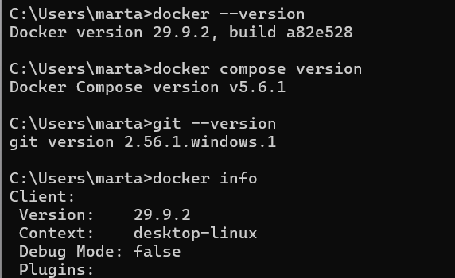
docker --version
Docker version 29.9.2, build a82e528

docker compose version
Docker Compose version v5.6.1

git --version
git version 2.56.1.windows.1

docker info
Client:
 Version:    29.9.2
 Context:    desktop-linux
 Debug Mode: false

A API está em app.py, os testes em test_app.py, na pasta testes, o Compose em compose.yaml e a pipeline em Jenkinsfile.

## E02 - Dockerfile e container (3 valores)
Tag da imagem; docker ps; HTTP /health; utilizador efetivo do container:
A tag da imagem é natixis-support:1.0, portas 127.0.0.1:18080->8000/tcp (18080 no host e 8000 no container). O utilizador efetivo é appuser.
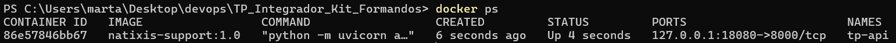
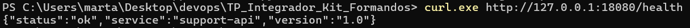
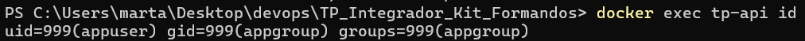
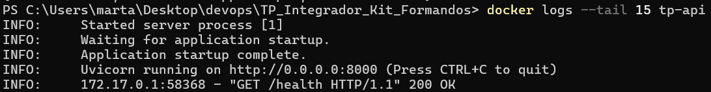

## E03 - Compose, DNS, healthcheck e volume (4 valores)
Resultado de docker compose config; health; teste checker -> api; contador antes/depois da recriacao:
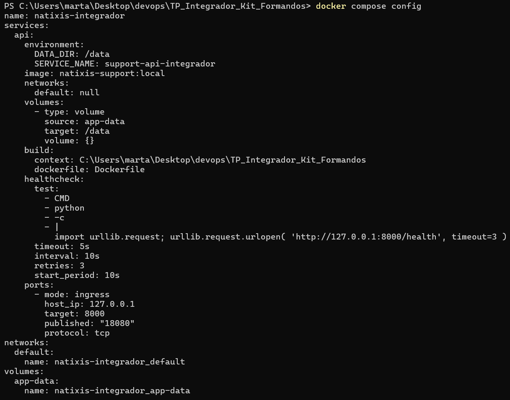
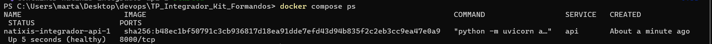
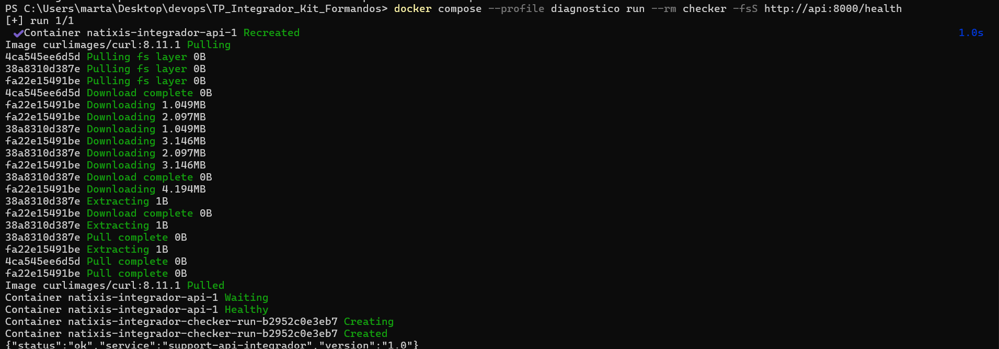
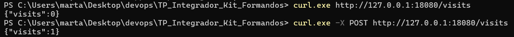
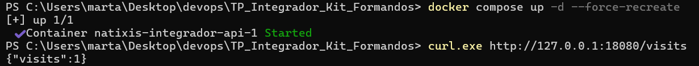
O contador não foi perdido porque foi criado um volume persistente /data, que guarda os dados no Docker host e não no container em si, por isso é que eles se mantêm com a recriação do container.

## E04 - Incidente Docker (3 valores)
Sintoma, comandos de investigacao, causa-raiz, alteracao realizada, prova da recuperacao e contador preservado:
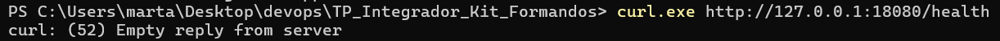
O problema, como se pode observar pelos dois comandos na imagem abaixo, é que o compose mapeia o tráfego para a porta 8000 enquanto o incidente.yaml escuta na porta 8001.
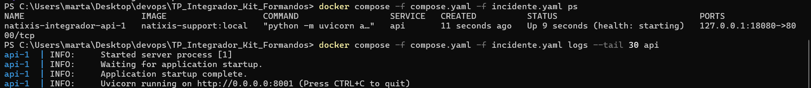
Se corrigirmos a porta para 8000, obtemos os seguintes resultados, com o contador ainda preservado:
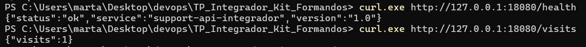

## E05 - Git (3 valores)
Branch, hashes de commits, merge e tag v1.0.0:

## E06 - Jenkins SUCCESS (4 valores)
URL/numero do build, etapas e identificador da imagem construida:

## E07 - Jenkins FAILURE e recuperacao (2 valores)
Build FAILURE, etapa que falhou e excerto relevante do log; build SUCCESS apos correcao:

## Verificacao final
[ ] Dockerfile [ ] compose.yaml [ ] app.py [ ] tests/ [ ] Jenkinsfile
[ ] Historico Git [ ] Tag v1.0.0 [ ] Evidencias E01-E07
